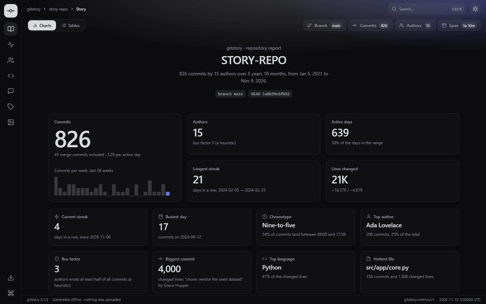
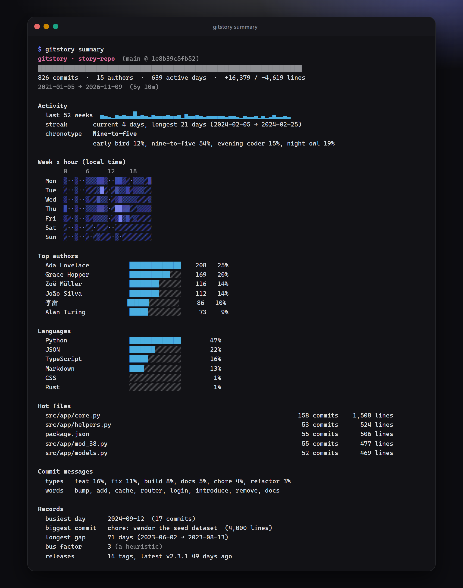
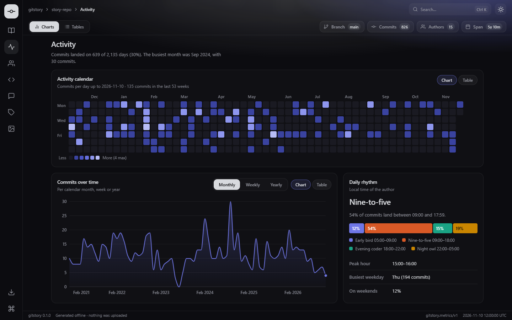
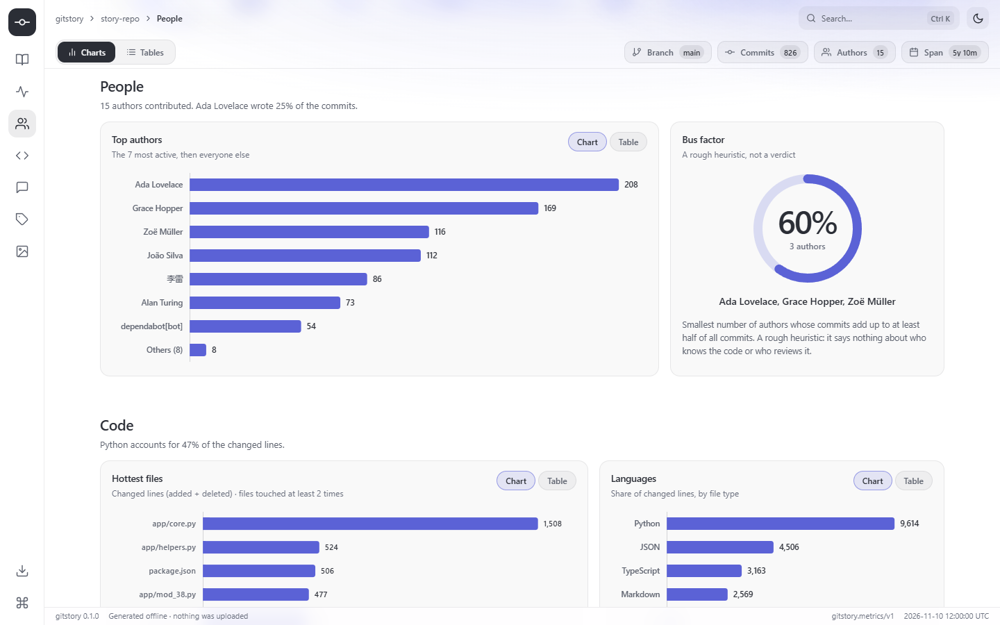
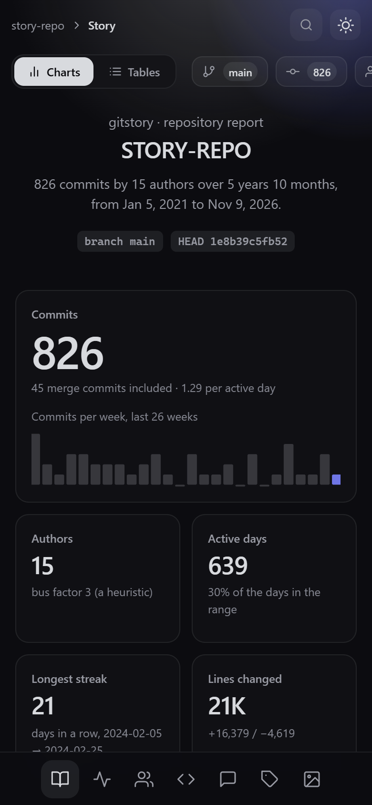
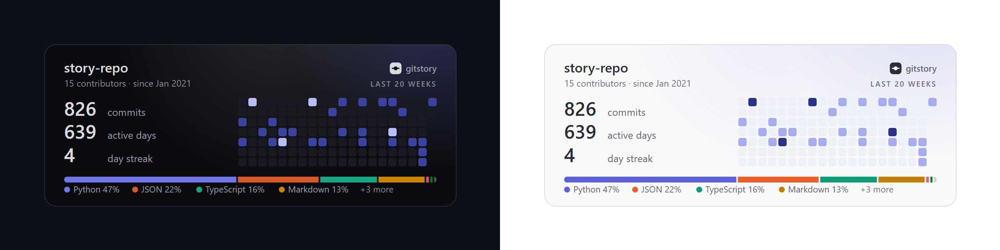
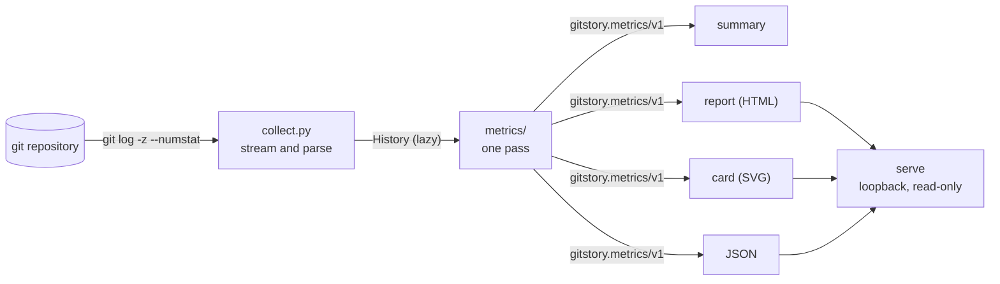

<p align="center">
  
</p>

**Your repository's story, animated.** One command turns a git history into a wrapped-style HTML
dashboard, JSON metrics and an animated SVG card for your README. Python standard library only.

[](https://www.python.org/)
[](LICENSE)
[](https://github.com/q6r/gitstory/actions/workflows/ci.yml)

English · [Português](README.pt-BR.md)

<p align="center">
  
</p>

## Why gitstory

- **A story, not a spreadsheet.** Streaks, quiet spells, your busiest day, when you really work,
  who wrote what: the numbers a git history is made of, arranged the way a year-in-review page
  would, with every chart one click from its table.
- **It never leaves your machine.** No account, token, upload or telemetry. It reads your
  history with `git`, writes files, and the report works offline from `file://`. Private
  repositories are fine. See [what is read and what is written](docs/privacy.md).
- **Safe to point at a stranger's repository.** Author names, subjects and paths are treated as
  hostile: nothing is executed, everything is bounded, and every output escapes what it prints. The
  local server cannot read your disk. See the [security notes](#security-notes).

## Features

- **Five commands**: `summary` (terminal), `json`, `report` (one HTML file), `card` (animated
  SVG) and `serve` (the report, live, on `127.0.0.1`).
- **The metrics behind the story**: activity by day, week, month and year; a 53-week calendar; a
  weekday x hour heatmap; streaks; authors and a bus-factor heuristic; churn hotspots; languages;
  commit sizes; Conventional Commits mix; top words; chronotype; release cadence. Every number is
  [defined and explained](docs/metrics.md).
- **A real dashboard**, laid out like an app: a rail with the sections, breadcrumbs and search in
  the top bar, a Charts/Tables switch and the repository's facts under it, highlight cards, a
  Chart/Table view on every chart, a command palette (`Ctrl`+`K`), a dark and a light theme,
  keyboard access, reduced-motion support, responsive from 360 px to 1920 px, and no network
  requests at all.
- **A README card** that renders on GitHub: pure SVG and CSS, no script, no external requests,
  follows the viewer's colour scheme.
- **Choose your history**: `--since`, `--until`, `--author`, `--branch`, `--path`, `--no-merges`,
  `--max-commits`. Renames are followed and a `.mailmap` is honoured.
- **Reproducible**: the same repository and clock give byte-identical output
  (`SOURCE_DATE_EPOCH`), so reports and cards can live in version control.
- **Streams, never loads**: constant memory however long the history.
- **Typed, tested, documented**: strict `mypy`, `ruff`, about a thousand tests and a
  [reference for every field](docs/metrics.md).

## Quick start

You need Python 3.10 or newer and `git`. Get the source from
[github.com/q6r/gitstory](https://github.com/q6r/gitstory) and, inside the folder:

```bash
python -m pip install .
```

Then, in any git repository (Windows, macOS and Linux alike):

```bash
gitstory report     # writes gitstory.html: open it in a browser
gitstory card       # writes card.svg for your README
gitstory summary    # prints an overview in the terminal
```

```text
gitstory: wrote gitstory.html (346,992 bytes)
gitstory: wrote card.svg (19,149 bytes)
```

`python -m gitstory ...` works as well, and `gitstory --help` lists everything.

## Usage

The examples run on a synthetic repository (about 800 commits by 15 authors over six years) that
[`examples/generate.py`](examples/generate.py) builds, with the clock pinned so the numbers repeat.
The files it writes are in [`examples/`](examples). The full reference is
[docs/usage.md](docs/usage.md).

### Terminal summary

```bash
gitstory summary
```

<p align="center">
  
</p>

Colour follows the terminal, `NO_COLOR` and `--color`; the bars fall back to ASCII when the
terminal cannot show blocks. Choose the history with the filters:

```bash
gitstory summary --since 2024-01-01 --until 2024-12-31 --author ada
```

```text
gitstory · story-repo  (main @ 1e8b39c5fb52)
████████████████████████████████████████████████████████████████████████
42 commits  ·  1 author  ·  41 active days  ·  +527 / -407 lines
2024-01-11 → 2024-12-15  (11m)

Activity
  last 52 weeks  ▄▄▄▁▄▆▄▄▁▁▄▄▄▁▄▄▁▁▄▁▁▄▆█▄▆▁▁▁▄▁▄▁▁▄▄▆▄▁▁█▆▁▄█▄▁▄▄▁▁▁
  streak       current 0 days, longest 2 days (2024-02-11 → 2024-02-12)
  chronotype   Evening coder
               early bird 0%, nine-to-five 0%, evening coder 38%, night owl 62%
```

### The dashboard

```bash
gitstory report -o story.html
```

```text
gitstory: wrote story.html (346,992 bytes)
```

One self-contained file: the UI kit, the code and the data are inside, so you can mail it,
archive it or open it from a USB stick. Sections: story and highlights, activity (calendar,
commits over time, weekday x hour), people (authors, bus factor), code (hot files, languages,
commit sizes), messages (types, words), releases, and the README card.

The sections are the icons of the rail on the left, which follows the scroll (below 760 px it
becomes a bar at the bottom). The top bar shows where you are, has the search button that opens
the command palette and the theme toggle; the bar under it holds the Charts/Tables switch, which
turns every chart into its table, and the facts of the repository: branch, commits, authors and
time span. The dark theme is Prism Classic (a near-black ground, silver ink, one indigo accent),
the light one is Prism Daylight.

<table>
  <tr>
    <td width="50%"></td>
    <td width="50%"></td>
  </tr>
  <tr>
    <td colspan="2" align="center"><sub>Dark and light themes. Every chart has a Table view, <code>Ctrl</code>+<code>K</code> opens the command palette, and the layout follows the screen down to a phone, where the rail moves to the bottom.</sub></td>
  </tr>
</table>

<p align="center">
  
</p>

### The README card

```bash
gitstory card -o card.svg
```

```markdown

```

<p align="center">
  
</p>

The card above is `examples/card.svg`, the real thing, inline: it animates, switches with your
GitHub theme and makes no requests. `--theme dark|light` pins the colours, `--title` renames
it, `--width`, `--height` and `--weeks` change the shape. Here are the dark and light variants on
the backgrounds GitHub uses:

<p align="center">
  
</p>

### JSON

```bash
gitstory json
```

```text
{
  "schema": "gitstory.metrics/v1",
  "generator": {
    "name": "gitstory",
    "version": "0.1.0"
  },
  "generatedAt": "2026-11-10T12:00:00Z",
  "repository": {
    "name": "story-repo",
    "branch": "main",
    "detached": false,
    "head": "1e8b39c5fb52",
    "shallow": false
  },
  ...
```

The whole document is in [`examples/metrics.json`](examples/metrics.json); it is the single
source of everything the other commands show. Warnings go to stderr, so the JSON on stdout is
always valid.

### Serve it

```bash
gitstory serve --port 17320
```

```text
gitstory: analysing . ...
gitstory: serving http://127.0.0.1:17320/ (Ctrl+C to stop)
```

The page has a *Live* indicator and a refresh button. The server also answers
`GET /api/metrics.json` and `GET /card.svg?theme=dark`, and refuses anything else:

```bash
curl -s -H "Host: evil.example" http://127.0.0.1:17320/
```

```text
{"error": "host not allowed"}
```

### Exit codes

`0` success, `2` invalid usage, `3` no `git`, `4` not a repository or unknown revision, `5` no
commits, `6` git failed, `7` output could not be written, `130` interrupted. Errors say what to
do:

```text
gitstory: error: . is not inside a git repository (run gitstory in a clone, or pass the path of one)
```

## Architecture



Read, reduce, render: a one-way pipeline in which the renderers are pure functions of one metrics
document. [docs/architecture.md](docs/architecture.md) explains the modules, the decisions and
how the server and the tests work.

## Project layout

```text
gitstory/
├── src/gitstory/
│   ├── cli.py            commands, options, exit codes
│   ├── collect.py        runs git and parses its output (streaming, bounded)
│   ├── model.py          Commit, FileChange, Tag, History, Filters and the errors
│   ├── languages.py      file types and the generated-file filter
│   ├── util.py           clock, dates, text sanitising, JSON helpers
│   ├── metrics/          one accumulator per topic, plus compute_metrics
│   ├── render/           terminal.py, html.py, svg_card.py
│   ├── serve.py          the loopback HTTP server
│   └── assets/           report.html, app.js, app.css and the bundled Aurora UI kit
├── tests/                synthetic repository with an oracle, hostile fixtures, ~1,000 tests
├── examples/             generate.py and the files it writes (JSON, report, cards, summary)
├── docs/                 architecture, metrics, usage, privacy, screenshots
├── assets/banner.svg
└── pyproject.toml  CHANGELOG.md  CONTRIBUTING.md  SECURITY.md  LICENSE  .github/
```

## Configuration

There is no configuration file: everything is a flag or an environment variable.

| Setting | Applies to | Default | Meaning |
|---|---|---|---|
| `path` | all | `.` | Any directory inside the repository. |
| `--since`, `--until` | all | none | Date window: `YYYY-MM-DD`, ISO-8601 or relative (`90d`, `12w`, `6m`, `1y`). |
| `--author REGEX` | all | none | Only matching authors (name or e-mail, case-insensitive). |
| `--branch REV` | all | `HEAD` | A branch, tag or commit. |
| `--path PATHSPEC` | all | none | Only commits touching the path (repeatable). |
| `--no-merges`, `--max-commits N` | all | off | Leave merges out; keep the newest `N`. |
| `-o, --output FILE` | `report`, `json`, `card` | `gitstory.html`, `-` (stdout), `card.svg` | Where to write (`-` is stdout). |
| `--theme auto\|dark\|light` | `report`, `serve`, `card` | `auto` | Colour theme. |
| `--compact` | `json` | off | No indentation. |
| `--width`, `--height`, `--weeks`, `--title` | `card` | 495, 195, 20, the repository name | Card geometry and title. |
| `--color auto\|always\|never` | `summary` | `auto` | When to use colour. |
| `--host`, `--port` | `serve` | `127.0.0.1`, `8787` | Where to listen. Loopback only. |
| `--allow-remote` | `serve` | off | Allow another address. **No authentication.** |
| `--open`, `-v` | `serve` | off | Open a browser; log requests. |
| `--debug` | all | off | Traceback on unexpected errors. |
| `SOURCE_DATE_EPOCH` | all | the real clock | Pins "now" for reproducible output. |
| `NO_COLOR`, `COLUMNS` | `summary` | unset | Colour and width conventions. |

## Security notes

gitstory reads repositories you may not trust, so it is built around that. Each point below has
tests; the hostile-input fixtures contain shell metacharacters, HTML, escape sequences,
bidirectional overrides, huge subjects and awkward paths.

- **Nothing from a repository is executed.** The only program started is `git`, with a fixed
  argument list (no shell), found through `PATH` entries that are absolute, with a scrubbed
  environment, no pager, no external diff or text converter, and revisions that look like options
  or ranges refused. File contents are never read, only names and line counts.
- **Everything is bounded**: git output tokens, names, subjects, paths, files per commit, tags,
  tracked files, series lengths, request sizes and request times.
- **Outputs escape what they print.** The terminal gets control and bidirectional-override
  characters replaced by visible placeholders. The SVG is XML-escaped and inert. The HTML page
  receives data only through a JSON block whose `<`, `>`, `&` and line separators are written as
  JSON escapes, so no value can close the script element; the dashboard places every string with
  `textContent`; and a content-security policy lists the SHA-256 of every inline script and style,
  allows no request except to its own origin and images only from `data:`.
- **The server is a closed box.** It listens on loopback and refuses other addresses without
  `--allow-remote`; it checks the `Host` header (DNS rebinding); its routes are a fixed table, so
  no URL ever touches the file system; it only reads, except for one same-origin, rate-limited
  refresh; and it sets `X-Frame-Options`, `Cross-Origin-Resource-Policy`, a strict
  content-security policy and `nosniff` on every response.
- **Privacy**: nothing leaves the machine, and e-mail addresses are never written. See
  [docs/privacy.md](docs/privacy.md) for what an output reveals, and think before you publish a
  report of a private repository.

Limits worth knowing: `serve --allow-remote` has no authentication; and gitstory asks git to
ignore external drivers but cannot make git ignore a repository's own configuration, so, as with
any git command, analyse repositories you trust or at least own the checkout of (git's
`safe.directory` check applies). To report a vulnerability, see [SECURITY.md](SECURITY.md).

## Testing

```bash
python -m pip install -e ".[dev]"
python -m pytest
python -m ruff check .
python -m ruff format --check .
python -m mypy
python -m coverage run -m pytest && python -m coverage report
```

On a laptop (Windows, Python 3.15, `git` 2.54) the suite runs 1,008 tests offline in about 30
seconds, with 99% line and branch coverage; `ruff` and strict `mypy` are clean. CI runs the suite
on Linux, macOS and Windows with Python 3.10 to 3.14.

The tests are built around a deterministic synthetic repository with an independent oracle (a
71-day quiet gap, a 21-day streak, a 17-commit day and a 4,000-line import are planted and
asserted), a bare repository of hostile content, and seeded property-style tests for the parsers,
sanitisers and renderers. A real server is started on `127.0.0.1` (ports 17320 to 17399) to test
the Host check, path traversal, shutdown and resets. The dashboard itself was checked by hand in a
headless browser (dark, light, 390 px wide, hostile and empty data, the live page); the
screenshots here come from that.

## Roadmap

Ideas, not promises:

- One calendar per year for long histories (today the calendar covers the last 53 weeks).
- Word segmentation for Chinese, Japanese and Korean commit subjects.
- A `gitstory diff` between two ranges, and a combined report for several repositories.
- A JSON Schema file for `gitstory.metrics/v1`.
- A ready-made GitHub Action that refreshes the card on a schedule.

## Contributing

Issues and pull requests are welcome. [CONTRIBUTING.md](CONTRIBUTING.md) has the setup, the
checks and the rules (stdlib only at runtime, repository text is untrusted, outputs are
deterministic). Commits follow [Conventional Commits](https://www.conventionalcommits.org/).

## License

[MIT](LICENSE) © 2026 q6r.

## Credits

Inspired by the contribution graph on GitHub profiles, by year-in-review pages ("wrapped"), and
by tools such as [gitstats](https://github.com/hoxu/gitstats) and
[github-readme-stats](https://github.com/anuraghazra/github-readme-stats). The code is
independent; none of it comes from those projects. The dashboard is built with the Aurora UI
kit, three small dependency-free files (MIT) that live in `src/gitstory/assets/` next to the code
that uses them. The Conventional Commits convention is by its
[authors](https://www.conventionalcommits.org/).
