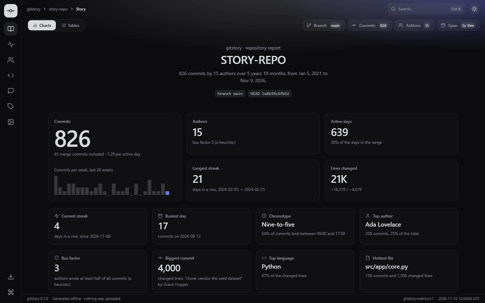
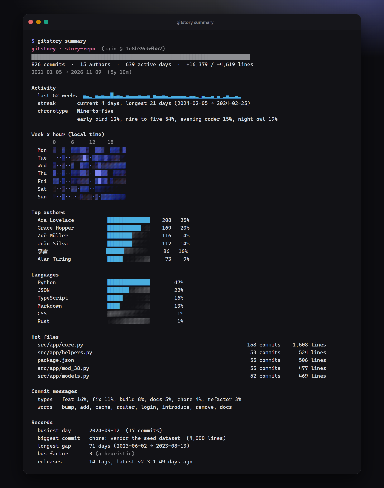
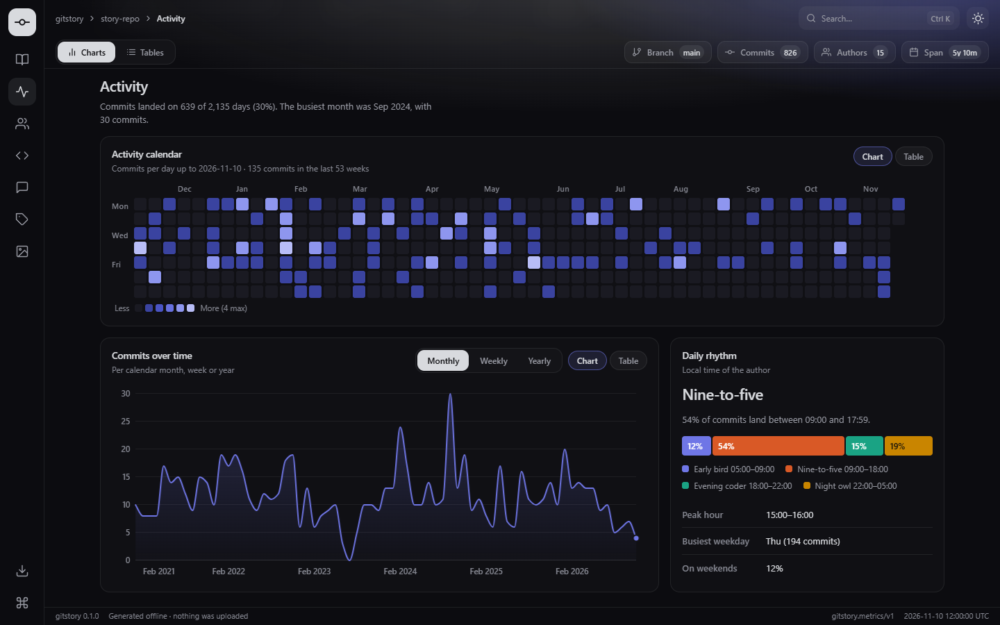
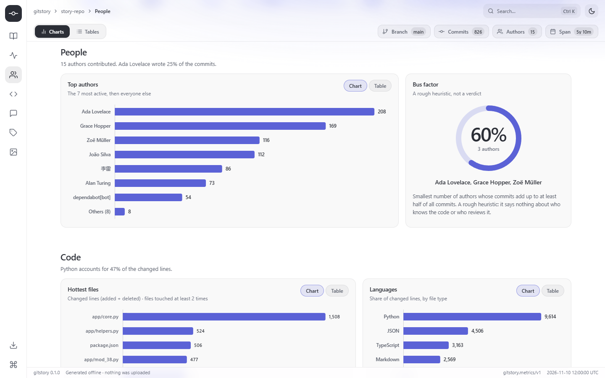
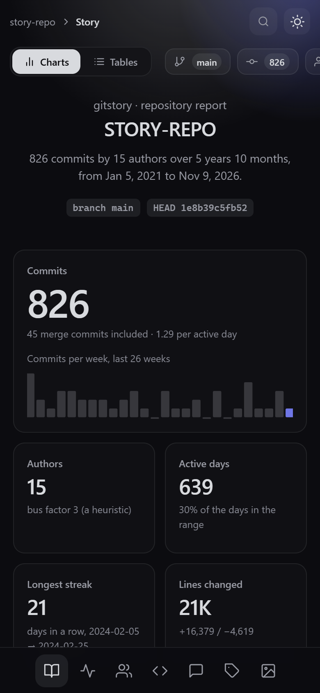
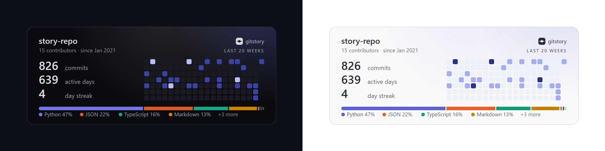
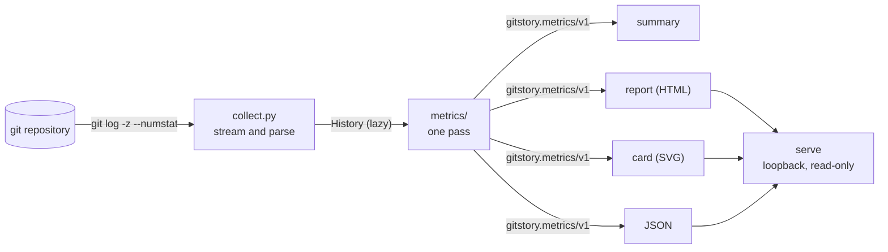

<p align="center">
  
</p>

**A história do seu repositório, animada.** Um comando transforma o histórico do git em um painel
HTML no estilo "retrospectiva", métricas em JSON e um cartão SVG animado para o seu README. Só a
biblioteca padrão do Python.

[](https://www.python.org/)
[](LICENSE)
[](https://github.com/q6r/gitstory/actions/workflows/ci.yml)

[English](README.md) · Português

<p align="center">
  
</p>

## Por que usar o gitstory

- **Uma história, não uma planilha.** Sequências de dias, períodos parados, o dia mais intenso,
  quando você realmente trabalha, quem escreveu o quê: os números de um histórico git, organizados
  como numa página de retrospectiva do ano, com cada gráfico a um clique da sua tabela.
- **Nada sai da sua máquina.** Sem conta, token, envio de dados ou telemetria. Ele lê o histórico
  com o `git`, escreve arquivos, e o relatório funciona offline, direto de `file://`. Repositórios
  privados não são problema. Veja [o que é lido e o que é escrito](docs/privacy.md).
- **Seguro até para o repositório de um desconhecido.** Nomes de autores, assuntos de commits e
  caminhos são tratados como hostis: nada é executado, tudo tem limite e toda saída escapa o que
  imprime. O servidor local não consegue ler o seu disco. Veja as
  [notas de segurança](#notas-de-segurança).

## Recursos

- **Cinco comandos**: `summary` (terminal), `json`, `report` (um único arquivo HTML), `card` (SVG
  animado) e `serve` (o relatório, ao vivo, em `127.0.0.1`).
- **As métricas por trás da história**: atividade por dia, semana, mês e ano; um calendário de 53
  semanas; um mapa de calor de dia da semana x hora; sequências; autores e uma heurística de fator
  de ônibus (*bus factor*); arquivos mais alterados; linguagens; tamanho dos commits; proporção de
  Conventional Commits; palavras mais usadas; cronótipo; cadência de releases. Cada número está
  [definido e explicado](docs/metrics.md).
- **Um painel de verdade**, montado como um aplicativo: uma barra lateral com as seções, trilha de
  navegação e busca na barra superior, um alternador Gráficos/Tabelas e os dados do repositório logo
  abaixo, cartões de destaques, visão de Gráfico/Tabela em todo gráfico, paleta de comandos
  (`Ctrl`+`K`), temas escuro e claro, acesso pelo teclado, respeito a movimento reduzido, layout
  responsivo de 360 px a 1920 px e nenhuma requisição de rede.
- **Um cartão para o README** que o GitHub renderiza: SVG e CSS puros, sem script, sem requisições
  externas, acompanhando o esquema de cores de quem vê.
- **Escolha o histórico**: `--since`, `--until`, `--author`, `--branch`, `--path`, `--no-merges`,
  `--max-commits`. Renomeações são acompanhadas e o `.mailmap` é respeitado.
- **Reproduzível**: o mesmo repositório e o mesmo relógio geram saídas idênticas byte a byte
  (`SOURCE_DATE_EPOCH`), então relatórios e cartões podem ficar no controle de versão.
- **Lê em fluxo, nunca carrega tudo**: memória constante, não importa o tamanho do histórico.
- **Tipado, testado, documentado**: `mypy` estrito, `ruff`, cerca de mil testes e uma
  [referência de cada campo](docs/metrics.md).

## Início rápido

Você precisa do Python 3.10 ou mais novo e do `git`. Pegue o código em
[github.com/q6r/gitstory](https://github.com/q6r/gitstory) e, dentro da pasta:

```bash
python -m pip install .
```

Depois, em qualquer repositório git (Windows, macOS e Linux igualmente):

```bash
gitstory report     # grava gitstory.html: abra no navegador
gitstory card       # grava card.svg para o seu README
gitstory summary    # imprime um resumo no terminal
```

```text
gitstory: wrote gitstory.html (346,992 bytes)
gitstory: wrote card.svg (19,149 bytes)
```

`python -m gitstory ...` também funciona, e `gitstory --help` lista tudo. As mensagens do programa
ficam em inglês.

## Uso

Os exemplos rodam em um repositório sintético (cerca de 800 commits de 15 autores ao longo de seis
anos) que o [`examples/generate.py`](examples/generate.py) constrói, com o relógio fixo para que os
números se repitam. Os arquivos que ele gera estão em [`examples/`](examples). A referência
completa (em inglês) é o [docs/usage.md](docs/usage.md).

### Resumo no terminal

```bash
gitstory summary
```

<p align="center">
  
</p>

A cor segue o terminal, o `NO_COLOR` e o `--color`; as barras caem para ASCII quando o terminal
não mostra blocos. Escolha o histórico com os filtros:

```bash
gitstory summary --since 2024-01-01 --until 2024-12-31 --author ada
```

```text
gitstory · story-repo  (main @ 1e8b39c5fb52)
████████████████████████████████████████████████████████████████████████
42 commits  ·  1 author  ·  41 active days  ·  +527 / -407 lines
2024-01-11 → 2024-12-15  (11m)

Activity
  last 52 weeks  ▄▄▄▁▄▆▄▄▁▁▄▄▄▁▄▄▁▁▄▁▁▄▆█▄▆▁▁▁▄▁▄▁▁▄▄▆▄▁▁█▆▁▄█▄▁▄▄▁▁▁
  streak       current 0 days, longest 2 days (2024-02-11 → 2024-02-12)
  chronotype   Evening coder
               early bird 0%, nine-to-five 0%, evening coder 38%, night owl 62%
```

### O painel

```bash
gitstory report -o story.html
```

```text
gitstory: wrote story.html (346,992 bytes)
```

Um único arquivo autossuficiente: o kit de UI, o código e os dados estão dentro, então
você pode mandar por e-mail, arquivar ou abrir de um pendrive. Seções: história e destaques,
atividade (calendário, commits ao longo do tempo, dia da semana x hora), pessoas (autores, fator
de ônibus), código (arquivos mais alterados, linguagens, tamanho dos commits), mensagens (tipos,
palavras), releases e o cartão do README.

As seções são os ícones da barra à esquerda, que acompanha a rolagem (abaixo de 760 px ela vira
uma barra na parte de baixo). A barra superior mostra onde você está, tem o botão de busca que
abre a paleta de comandos e o botão de tema; a barra logo abaixo traz o alternador
Gráficos/Tabelas, que transforma todos os gráficos em tabelas, e os dados do repositório: branch,
commits, autores e período. O tema escuro é o Prism Classic (fundo quase preto, texto prateado, um
único destaque em índigo) e o claro é o Prism Daylight.

<table>
  <tr>
    <td width="50%"></td>
    <td width="50%"></td>
  </tr>
  <tr>
    <td colspan="2" align="center"><sub>Temas escuro e claro. Todo gráfico tem visão de Tabela, <code>Ctrl</code>+<code>K</code> abre a paleta de comandos e o layout acompanha a tela até o celular, onde a barra lateral vai para baixo.</sub></td>
  </tr>
</table>

<p align="center">
  
</p>

### O cartão do README

```bash
gitstory card -o card.svg
```

```markdown

```

<p align="center">
  
</p>

O cartão acima é o `examples/card.svg`, o arquivo de verdade, direto na página: ele anima, muda
com o tema do seu GitHub e não faz requisições. `--theme dark|light` fixa as cores, `--title` o
renomeia, `--width`, `--height` e `--weeks` mudam o formato. Aqui estão as variantes escura e clara
sobre os fundos que o GitHub usa:

<p align="center">
  
</p>

### JSON

```bash
gitstory json
```

```text
{
  "schema": "gitstory.metrics/v1",
  "generator": {
    "name": "gitstory",
    "version": "0.1.0"
  },
  "generatedAt": "2026-11-10T12:00:00Z",
  "repository": {
    "name": "story-repo",
    "branch": "main",
    "detached": false,
    "head": "1e8b39c5fb52",
    "shallow": false
  },
  ...
```

O documento completo está em [`examples/metrics.json`](examples/metrics.json); ele é a fonte única
de tudo que os outros comandos mostram. Os avisos vão para o stderr, então o JSON no stdout é
sempre válido.

### Servidor local

```bash
gitstory serve --port 17320
```

```text
gitstory: analysing . ...
gitstory: serving http://127.0.0.1:17320/ (Ctrl+C to stop)
```

A página tem um indicador *Live* e um botão de atualizar. O servidor também responde
`GET /api/metrics.json` e `GET /card.svg?theme=dark`, e recusa todo o resto:

```bash
curl -s -H "Host: evil.example" http://127.0.0.1:17320/
```

```text
{"error": "host not allowed"}
```

### Códigos de saída

`0` sucesso, `2` uso inválido, `3` sem `git`, `4` não é um repositório ou revisão inexistente, `5`
sem commits, `6` falha do git, `7` não foi possível gravar a saída, `130` interrompido. Os erros
dizem o que fazer:

```text
gitstory: error: . is not inside a git repository (run gitstory in a clone, or pass the path of one)
```

## Arquitetura



Ler, reduzir, renderizar: um pipeline de mão única em que os renderizadores são funções puras de
um único documento de métricas. O [docs/architecture.md](docs/architecture.md) (em inglês) explica
os módulos, as decisões e como o servidor e os testes funcionam.

## Estrutura do projeto

```text
gitstory/
├── src/gitstory/
│   ├── cli.py            comandos, opções, códigos de saída
│   ├── collect.py        executa o git e interpreta a saída (em fluxo, com limites)
│   ├── model.py          Commit, FileChange, Tag, History, Filters e os erros
│   ├── languages.py      tipos de arquivo e o filtro de arquivos gerados
│   ├── util.py           relógio, datas, limpeza de texto, auxiliares de JSON
│   ├── metrics/          um acumulador por assunto, mais compute_metrics
│   ├── render/           terminal.py, html.py, svg_card.py
│   ├── serve.py          o servidor HTTP em loopback
│   └── assets/           report.html, app.js, app.css e o kit de UI Aurora incluído
├── tests/                repositório sintético com oráculo, fixtures hostis, ~1.000 testes
├── examples/             generate.py e os arquivos que ele gera (JSON, relatório, cartões, resumo)
├── docs/                 arquitetura, métricas, uso, privacidade, capturas de tela
├── assets/banner.svg
└── pyproject.toml  CHANGELOG.md  CONTRIBUTING.md  SECURITY.md  LICENSE  .github/
```

## Configuração

Não há arquivo de configuração: tudo é opção de linha de comando ou variável de ambiente.

| Opção | Vale para | Padrão | Significado |
|---|---|---|---|
| `path` | todos | `.` | Qualquer diretório dentro do repositório. |
| `--since`, `--until` | todos | nenhum | Janela de datas: `YYYY-MM-DD`, ISO-8601 ou relativa (`90d`, `12w`, `6m`, `1y`). |
| `--author REGEX` | todos | nenhum | Só autores que casam (nome ou e-mail, sem diferenciar maiúsculas). |
| `--branch REV` | todos | `HEAD` | Um branch, tag ou commit. |
| `--path PATHSPEC` | todos | nenhum | Só commits que tocam o caminho (repetível). |
| `--no-merges`, `--max-commits N` | todos | desligado | Ignora merges; mantém os `N` mais recentes. |
| `-o, --output ARQUIVO` | `report`, `json`, `card` | `gitstory.html`, `-` (stdout), `card.svg` | Onde gravar (`-` é o stdout). |
| `--theme auto\|dark\|light` | `report`, `serve`, `card` | `auto` | Tema de cores. |
| `--compact` | `json` | desligado | Sem indentação. |
| `--width`, `--height`, `--weeks`, `--title` | `card` | 495, 195, 20, o nome do repositório | Formato e título do cartão. |
| `--color auto\|always\|never` | `summary` | `auto` | Quando usar cor. |
| `--host`, `--port` | `serve` | `127.0.0.1`, `8787` | Onde escutar. Só loopback. |
| `--allow-remote` | `serve` | desligado | Permite outro endereço. **Sem autenticação.** |
| `--open`, `-v` | `serve` | desligado | Abre o navegador; registra as requisições. |
| `--debug` | todos | desligado | Traceback em erros inesperados. |
| `SOURCE_DATE_EPOCH` | todos | o relógio real | Fixa o "agora" para saídas reproduzíveis. |
| `NO_COLOR`, `COLUMNS` | `summary` | não definidas | Convenções de cor e largura. |

## Notas de segurança

O gitstory lê repositórios em que você pode não confiar, e foi feito em torno disso. Cada ponto
abaixo tem testes; as fixtures hostis têm metacaracteres de shell, HTML, sequências de escape,
sobreposições bidirecionais, assuntos enormes e caminhos esquisitos.

- **Nada de um repositório é executado.** O único programa iniciado é o `git`, com uma lista de
  argumentos fixa (sem shell), encontrado em entradas absolutas do `PATH`, com o ambiente limpo,
  sem paginador, sem diff externo nem conversor de texto, e com revisões que parecem opções ou
  intervalos recusadas. O conteúdo dos arquivos nunca é lido, só nomes e contagem de linhas.
- **Tudo tem limite**: trechos da saída do git, nomes, assuntos, caminhos, arquivos por commit,
  tags, arquivos acompanhados, tamanho das séries, tamanho e tempo das requisições.
- **As saídas escapam o que imprimem.** O terminal troca caracteres de controle e de sobreposição
  bidirecional por marcadores visíveis. O SVG é escapado como XML e é inerte. A página HTML recebe
  os dados só por um bloco JSON cujos `<`, `>`, `&` e separadores de linha são escritos como
  escapes JSON, então nenhum valor consegue fechar o elemento de script; o painel coloca cada texto
  com `textContent`; e uma política de segurança de conteúdo lista o SHA-256 de cada script e
  estilo embutido, não permite requisições além da própria origem e só aceita imagens `data:`.
- **O servidor é uma caixa fechada.** Escuta em loopback e recusa outros endereços sem
  `--allow-remote`; confere o cabeçalho `Host` (DNS rebinding); suas rotas são uma tabela fixa,
  então nenhuma URL toca o sistema de arquivos; só lê, exceto por uma atualização da mesma origem
  com limite de frequência; e envia `X-Frame-Options`, `Cross-Origin-Resource-Policy`, uma política
  de segurança de conteúdo rígida e `nosniff` em toda resposta.
- **Privacidade**: nada sai da máquina e endereços de e-mail nunca são escritos. Veja o
  [docs/privacy.md](docs/privacy.md) (em inglês) para o que uma saída revela, e pense antes de
  publicar o relatório de um repositório privado.

Limites que vale conhecer: o `serve --allow-remote` não tem autenticação; e o gitstory pede ao git
que ignore drivers externos, mas não consegue fazê-lo ignorar a configuração do próprio
repositório, então, como com qualquer comando git, analise repositórios em que você confia ou cujo
checkout seja seu (a verificação `safe.directory` do git vale). Para relatar uma vulnerabilidade,
veja o [SECURITY.md](SECURITY.md).

## Testes

```bash
python -m pip install -e ".[dev]"
python -m pytest
python -m ruff check .
python -m ruff format --check .
python -m mypy
python -m coverage run -m pytest && python -m coverage report
```

Em um notebook (Windows, Python 3.15, `git` 2.54) a suíte roda 1.008 testes offline em cerca de 30
segundos, com 99% de cobertura de linhas e ramos; `ruff` e `mypy` estrito passam limpos. O CI roda
a suíte em Linux, macOS e Windows com Python 3.10 a 3.14.

Os testes giram em torno de um repositório sintético determinístico com um oráculo independente
(uma pausa de 71 dias, uma sequência de 21 dias, um dia de 17 commits e uma importação de 4.000
linhas são plantados e verificados), um repositório bare com conteúdo hostil e testes de
propriedades com semente fixa para os parsers, os limpadores de texto e os renderizadores. Um
servidor de verdade sobe em `127.0.0.1` (portas 17300 a 17399) para testar a verificação de Host,
travessia de caminhos, encerramento e conexões abortadas. O painel em si foi conferido à mão em um
navegador sem janela (escuro, claro, 390 px de largura, dados hostis e vazios, a página ao vivo);
as capturas de tela daqui vêm dessa conferência.

## Roadmap

Ideias, não promessas:

- Um calendário por ano para históricos longos (hoje o calendário cobre as últimas 53 semanas).
- Segmentação de palavras para assuntos de commits em chinês, japonês e coreano.
- Um `gitstory diff` entre dois intervalos e um relatório combinado de vários repositórios.
- Um arquivo JSON Schema para o `gitstory.metrics/v1`.
- Uma GitHub Action pronta que atualiza o cartão periodicamente.

## Como contribuir

Issues e pull requests são bem-vindos. O [CONTRIBUTING.md](CONTRIBUTING.md) (em inglês) traz a
preparação do ambiente, as verificações e as regras (só biblioteca padrão em tempo de execução,
texto de repositório é não confiável, saídas determinísticas). Os commits seguem os
[Conventional Commits](https://www.conventionalcommits.org/).

## Licença

[MIT](LICENSE) © 2026 q6r.

## Créditos

Inspirado pelo gráfico de contribuições dos perfis do GitHub, pelas páginas de retrospectiva do ano
("wrapped") e por ferramentas como o [gitstats](https://github.com/hoxu/gitstats) e o
[github-readme-stats](https://github.com/anuraghazra/github-readme-stats). O código é
independente; nenhuma parte vem desses projetos. O painel é construído com o kit de UI Aurora,
três arquivos pequenos e sem dependências (MIT) que ficam em `src/gitstory/assets/`, junto do
código que os usa. A convenção Conventional Commits é de seus
[autores](https://www.conventionalcommits.org/).
