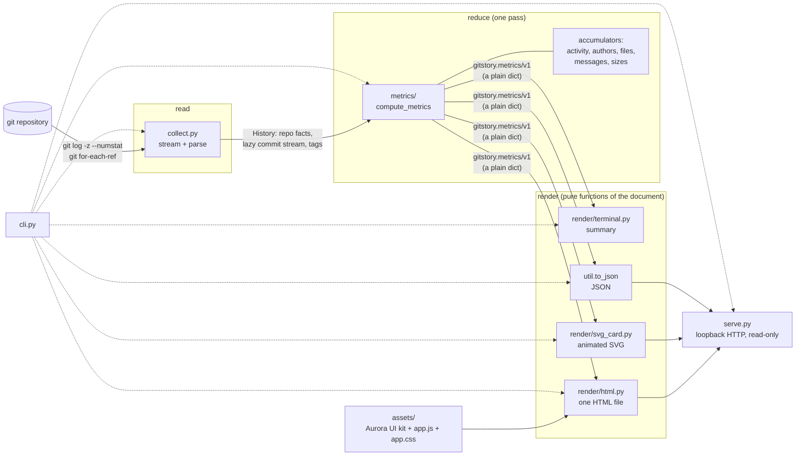
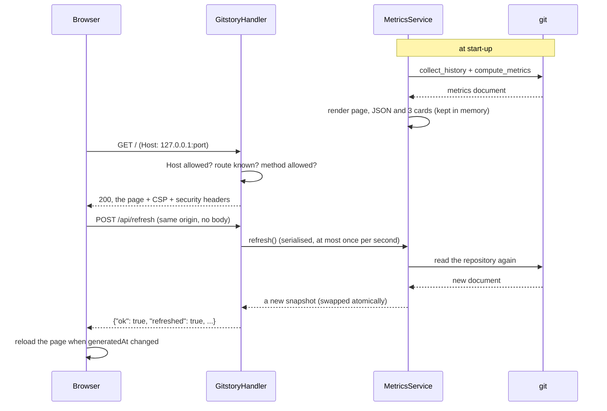

# Architecture

gitstory is a one-way pipeline: **read** the history with `git`, **reduce** it to one metrics
document, **render** that document in several ways. Nothing flows backwards, nothing is stored,
and the standard library is the only runtime dependency.

## The pieces

| Module | Responsibility |
|---|---|
| [`cli.py`](../src/gitstory/cli.py) | Argument parsing, the five commands and the mapping from errors to [exit codes](usage.md#exit-codes). The only place that prints or writes files. |
| [`collect.py`](../src/gitstory/collect.py) | Runs `git` and turns its output into `Commit` objects. Knows nothing about metrics. |
| [`model.py`](../src/gitstory/model.py) | Plain data types (`Commit`, `FileChange`, `Tag`, `RepoInfo`, `Filters`, `History`) and the error hierarchy. Imports nothing that touches git, the file system or the clock. |
| [`metrics/`](../src/gitstory/metrics) | One small accumulator per topic (`activity`, `authors`, `files`, `messages`, `sizes`), a classifier (`chronotype`), the release statistics and the `highlights`. `compute_metrics` feeds each commit to all of them once. |
| [`languages.py`](../src/gitstory/languages.py) | The extension and file-name table, and the "generated file" filter. |
| [`render/terminal.py`](../src/gitstory/render/terminal.py) | The `summary` text: colour, Unicode and width handling. |
| [`render/svg_card.py`](../src/gitstory/render/svg_card.py) | The animated card: layout, escaping, the SVG and its CSS. |
| [`render/html.py`](../src/gitstory/render/html.py) | Inlines the assets into one page, embeds the data and writes the content-security policy. |
| [`assets/`](../src/gitstory/assets) | The page: `report.html` (template), `app.js` and `app.css` (the dashboard) and the Aurora UI kit it is built on (`aurora.css`, `aurora.js`, `aurora-charts.js`: small, dependency-free files that belong to this repository). |
| [`serve.py`](../src/gitstory/serve.py) | The local HTTP server and `MetricsService`, which keeps the current snapshot (page, JSON, cards) in memory. |
| [`util.py`](../src/gitstory/util.py) | Clock, timestamp and date parsing, text sanitising, JSON helpers. |

## Decisions worth knowing

**Stream, do not load.** `git log -z --numstat` is read in 64 KiB chunks and parsed
incrementally; `compute_metrics` makes a single pass over the lazy stream. A repository with a
million commits costs time, not memory: the accumulators keep per-day, per-author and per-file
tallies, not commits. Every length that comes out of git (names, subjects, paths, tokens, files
per commit, tags) is bounded; see the [limits](metrics.md#limits).

**NUL-delimited, positional, forgery-proof.** Text-mode numstat (`{old => new}`) cannot be parsed
reliably, so the log is read with `-z`. Every commit record starts with a random per-run marker
that repository content cannot know, and the header fields behind it are consumed by position,
so a commit message that *looks* like a record boundary cannot start a record.

**One document, many views.** Everything a renderer shows is in the metrics document, including
the pre-computed highlight sentences. The renderers are pure functions of that document, so they
are testable without git, and `gitstory json` is exactly what the page, the card and the summary
are drawn from.

**Deterministic by construction.** The clock is a parameter (`compute_metrics(history, now=...)`,
and `SOURCE_DATE_EPOCH` for the command line), every list has a total order, and the renderers
add nothing random. The same repository gives byte-identical output, which is what makes the
files in [`examples/`](../examples) regenerable and the tests exact.

**Untrusted input, escaped at the last moment and again by the renderer.** Names, subjects, paths
and tags are cleaned once when they are read (control characters and bidirectional overrides
become visible placeholders) and escaped for each output format: XML-escaped in the card,
`html.escape`d in the page title and no-script summary, and placed in the page only through a
JSON data block whose `<`, `>`, `&`, U+2028 and U+2029 are written as JSON unicode escapes, which
makes it impossible to close the script element. In the browser every string is placed with
`textContent`; the dashboard never builds HTML from data.

**One self-contained file.** `render_report` inlines the three Aurora UI kit files, `app.css` and
`app.js` into the template, base64-embeds two copies of the README card for the preview, and adds a
content-security policy with the SHA-256 of every inline script and style (no `unsafe-inline` for
scripts, `connect-src 'self'`, images only from `data:`). The result works from `file://`, offline,
and under that policy, which `gitstory serve` also sends as an HTTP header.

**An app shell, then a column of sections.** `report.html` is nearly empty. `app.js` builds the
Aurora shell (the rail, the top bar, the sub bar and the status bar) and renders the report into
its container. One table of sections feeds the rail, the breadcrumbs, the command palette and the
scroll spy, so a new section is one row there and one render function. The *Charts / Tables*
switch of the sub bar flips every card made by `chartCard()`. The same file works from `file://`
and behind `gitstory serve`; the only difference is the `data-live` attribute, which adds the live
indicator and the refresh button to the top bar.

**A server that cannot read your disk.** `serve.py` has a fixed route table. No URL path is ever
decoded, joined to a directory or opened; there is no static-file handler. The bytes it sends are
rendered once and held in memory. See the [security notes](../README.md#security-notes).

## How `serve` works

## Tests

The suite (`pytest`, under a minute, offline) is built around a **synthetic repository** that
[`tests/fixtures/make_repo.py`](../tests/fixtures/make_repo.py) writes with `git fast-import`
from a seeded random generator: about 800 commits by a dozen people in different time zones,
branches and merges, renames, binary and Unicode file names, a `.mailmap`, annotated and
lightweight tags, and a few planted facts (a 71-day quiet gap, a 21-day streak, a 17-commit day,
a 4,000-line import). The builder keeps an independent **oracle** of every commit, so the
collector and the metrics are compared with ground truth rather than with themselves. A second
builder writes a bare repository full of hostile names, subjects and paths.

- `test_collect_*`: the parser (chunking, truncation, garbage, forged markers), the git
  invocation (fixed argv, scrubbed environment, timeouts, failures) against the oracle.
- `test_metrics_*`: every accumulator on hand-made histories, and the assembled document against
  the oracle and its planted facts.
- `test_render_*`: the HTML report (inlining, content-security policy, **hostile data cannot
  leave the data block**), the SVG card (well-formed XML, inert, layout, hostile text) and the
  terminal summary (colour rules, widths, escape sequences).
- `test_cli.py`, `test_serve.py`: every command and exit code, a real server on a loopback port
  (Host check, traversal, read-only, resets, shutdown) and real processes.
- `test_properties.py`: seeded random input for the parsers, sanitisers and renderers.
- `test_dashboard_assets.py`: static checks of `app.js` and `app.css` that need no browser.

The dashboard's pixels are checked by hand in a headless browser (dark, light, 390 px wide,
hostile and empty data, the live page); the screenshots in [`screenshots/`](screenshots) come from
that.
